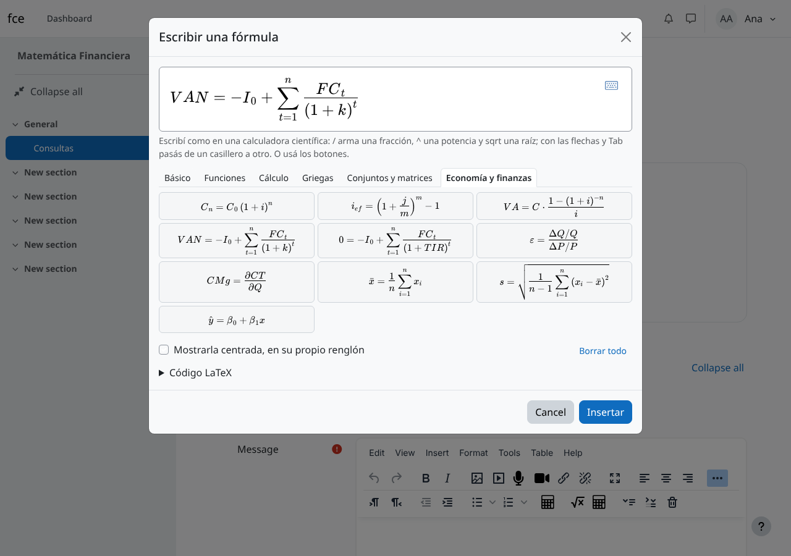
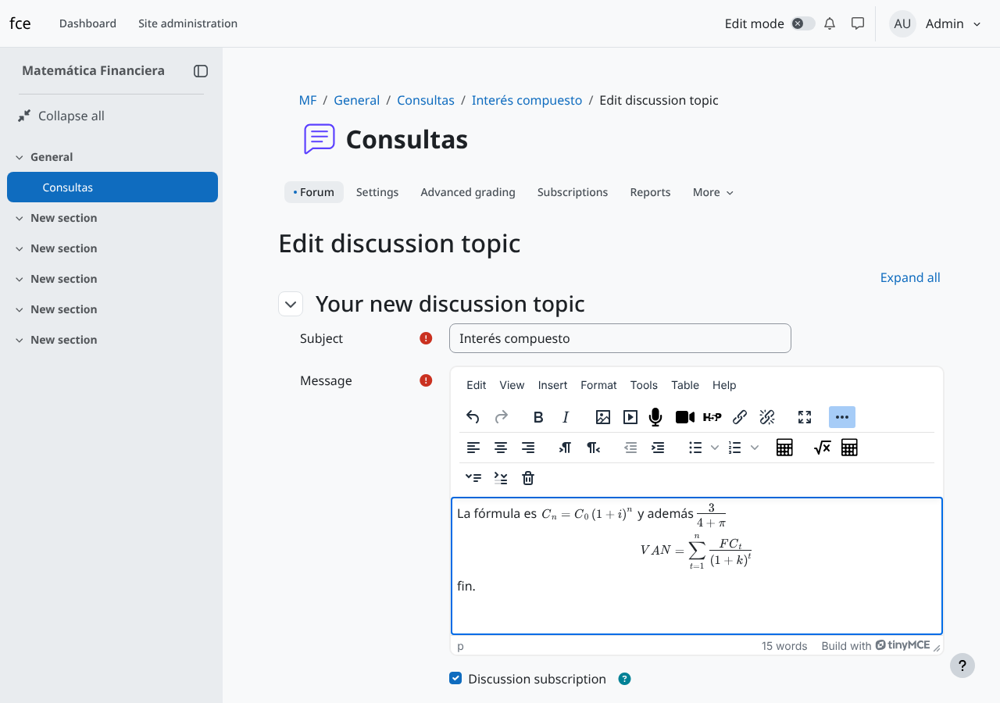
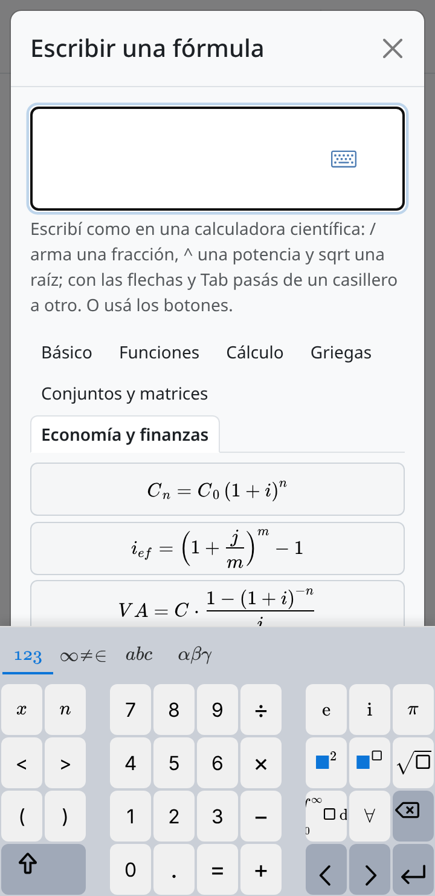

# Editor visual de ecuaciones para Moodle (`tiny_ecuaciones`)

*Visual equation editor* en inglés.

Plugin para el editor TinyMCE de Moodle que permite armar fórmulas en forma gráfica, con botones como los de una calculadora
científica, sin saber LaTeX. Lo pueden usar los docentes en recursos y actividades, y los alumnos
en foros, tareas, wikis y preguntas de ensayo de los cuestionarios.

Diseño y desarrollo: Gerardo Martín Gil Carretero (gerardo.gil@fce.uncu.edu.ar) · Equipo SIED ·
Facultad de Ciencias Económicas · UNCuyo.



## Qué hace

- Suma un botón **Fórmula** (√x) a la barra del editor y al menú **Insertar**.
- La fórmula se arma **en forma gráfica**: se elige un botón (fracción, potencia, raíz…) y se
  completan los casilleros que aparecen, viendo en todo momento la fórmula como va a quedar. No
  hace falta conocer ningún atajo ni código. Los botones están en seis solapas: Básico,
  Funciones, Cálculo, Griegas, Conjuntos y matrices, y **Economía y finanzas** (interés compuesto,
  tasa efectiva, valor actual, VAN, TIR, elasticidad, costo marginal, promedio, desvío y regresión).
- Al pie, chico como una nota, se puede ver y editar el **código LaTeX**, para quien lo sepa usar.
- Las fórmulas se ven dibujadas **dentro del editor**, y con doble clic se vuelven a editar.
- En celulares y tabletas aparece un teclado matemático en pantalla.
- Si quedan casilleros sin completar, la ventana lo avisa y no inserta la fórmula.
- Toda la interfaz está en español y en inglés.



## Cómo se guarda (y por qué)

La fórmula se guarda como **texto LaTeX** entre `\( … \)` (en línea) o `\[ … \]` (centrada). En la
página la dibuja el **filtro MathJax** que trae Moodle. El plugin no deja ningún rastro propio en el
contenido:

- **Sobrevive a la limpieza de HTML.** Moodle limpia con HTMLPurifier lo que escriben los alumnos, y
  ese filtro descarta SVG y MathML. El texto LaTeX pasa intacto.
- **No hay dependencia.** Si algún día se desinstala el plugin, las fórmulas se siguen viendo
  igual, y el editor de ecuaciones de Moodle las puede seguir editando.
- **Es el formato de Moodle.** Las fórmulas escritas antes con `\( \)`, `\[ \]` o `$$ $$` también se
  dibujan en el editor y se pueden editar con este plugin.

## Requisitos

- **Moodle 4.5 o posterior.** Cada cambio se prueba en 4.5, 5.0, 5.1, 5.2 y 5.3 (TinyMCE 7 y 8).
  Cuando sale una versión nueva de Moodle, se suma a las pruebas (`.github/workflows/ci.yml`).
- El filtro **«MathJax»** activo (Administración del sitio → Extensiones → Filtros). Viene activo
  de fábrica. Si no lo está, la ventana avisa que las fórmulas se van a ver como código.
- Nada más: no lleva base de datos propia, ni tareas programadas, ni servicios externos. MathLive
  viene incluido en el plugin (`vendor/mathlive`) y se sirve desde el mismo Moodle, sin CDN.

## Instalación

El nombre de la carpeta tiene que ser **`ecuaciones`**.

**Opción A — desde la administración de Moodle.** Bajar `tiny_ecuaciones-<versión>.zip` de la
página [Releases](https://github.com/SIED-Facultad-de-Ciencias-Economicas/moodle-tiny_ecuaciones/releases)
del repositorio (el que **no** dice «directorio») y subirlo en Administración del sitio →
Extensiones → Instalar complementos.

**Opción B — en el servidor.**

```bash
cd <raíz de Moodle>/public/lib/editor/tiny/plugins
```

```bash
git clone https://github.com/SIED-Facultad-de-Ciencias-Economicas/moodle-tiny_ecuaciones.git ecuaciones
```

```bash
php <raíz de Moodle>/admin/cli/upgrade.php
```

En Moodle 4.5 y 5.0 la carpeta es `lib/editor/tiny/plugins` (sin `public/`).

### Después de instalar

- El botón aparece solo, para todos los usuarios (permiso `tiny/ecuaciones:use`, que por defecto
  tiene el rol «Usuario autenticado», igual que el editor de ecuaciones de Moodle).
- **Recomendado:** desactivar el «Editor de ecuaciones» de Moodle (`tiny_equation`) en la lista de
  complementos del editor TinyMCE (Administración del sitio → Extensiones → Editores de texto).
  Si se dejan los dos, docentes y alumnos ven dos botones de fórmula. Son compatibles: guardan en
  el mismo formato.
- **MathJax:** Moodle lo carga desde un CDN (`cdn.jsdelivr.net`). Si la red del campus lo bloquea,
  se puede alojar MathJax en el propio servidor y apuntar el ajuste `filter_mathjaxloader/httpsurl` a esa copia.

## Qué no hace

- **App Moodle:** la app no usa TinyMCE, así que el botón no aparece ahí. Las fórmulas sí se ven.
- **Preguntas de respuesta corta, numérica o calculada:** esas respuestas son campos de texto, no
  editores. El botón aparece en las de **ensayo**.
- **Corregir respuestas matemáticas:** no evalúa nada. Para eso está el tipo de pregunta STACK.
- No reconoce escritura a mano ni convierte fórmulas de MathType pegadas desde Word.

## Desarrollo

```
amd/src/        código fuente (módulos ES)        amd/build/   lo que carga Moodle
classes/        plugininfo (configuración) y privacidad
lang/en, es     textos                            templates/   ventana (Mustache)
vendor/mathlive copia de MathLive 0.111.4         styles.css   estilos de la ventana
```

- Los botones de la paleta están en `amd/src/paleta.js`. Cada uno lleva su nombre en
  `lang/*/tiny_ecuaciones.php` (cadena `b_<clave>`).
- **`amd/build` lo compila GitHub.** Al subir un cambio en `amd/src`, la Action «Compilar
  JavaScript» lo pasa por el `grunt` de Moodle y sube `amd/build` a la misma rama. También se puede
  correr a mano desde la pestaña Actions. Con un Moodle de desarrollo a mano, da lo mismo correr
  `npx grunt amd` desde su raíz.
- **Pruebas:** cada push corre la Action «Pruebas de Moodle» (`moodle-plugin-ci`): estilo de código,
  PHPDoc, validación, plantillas, `grunt`, PHPUnit (`tests/`) y Behat (`tests/behat/`). Son los
  mismos controles que usa el equipo de Moodle para revisar los plugins del directorio.
- **Publicar una versión:** subir `$plugin->version` y `$plugin->release` en `version.php`,
  anotar los cambios en `CHANGES.md` y, ya en `main`, correr Actions → «Publicar versión» → Run
  workflow (sobre `main`). Crea la etiqueta `v<release>` (por ejemplo `v0.2.0`) y deja en Releases
  dos ZIP: el completo, para la FCE, y el «directorio», sólo con inglés, para moodle.org/plugins.
  También corre si se sube la etiqueta a mano; en ese caso controla que coincida con `version.php`.
- **moodle.org:** lo que va en cada campo del directorio de plugins está en
  [`docs/ficha-moodle-org.md`](docs/ficha-moodle-org.md).
- **Traducciones:** el directorio de Moodle carga las traducciones desde AMOS
  (lang.moodle.org), no desde el plugin. Una vez aprobado, el español de `lang/es/` se sube ahí; el
  ZIP completo lo sigue trayendo para que la FCE no dependa de eso.
- Para actualizar MathLive: reemplazar `vendor/mathlive` por `mathlive.min.js`, `mathlive-static.css`,
  `mathlive-fonts.css`, `fonts/` y `LICENSE.txt` del paquete nuevo, y cambiar la versión en
  `thirdpartylibs.xml`.

## Cómo se probó

**Pruebas automáticas.** Cada cambio pasa por `moodle-plugin-ci` en Moodle 4.5, 5.0, 5.1, 5.2 y 5.3,
cada una con el PHP más viejo que admite: estilo de código, PHPDoc, validación, plantillas, `grunt`, PHPUnit y cuatro escenarios
Behat (insertar con los botones, el aviso de casilleros vacíos, el dibujo de las fórmulas guardadas
con su vuelta a LaTeX, y la reedición).

**A mano**, en Moodle 4.5.15+ y 5.3+ con PostgreSQL y Chromium:

- Abrir un mensaje de foro con fórmulas `\( \)` y `$$ $$`: se dibujan en el editor y el texto no
  queda marcado como modificado.
- Armar fórmulas sólo con botones y clics en los casilleros; reeditar con doble clic; editar el
  código LaTeX; publicar. En la base queda LaTeX limpio.
- Lo mismo como **alumno** (rol estudiante), con la interfaz en español: el LaTeX pasa la limpieza
  de HTML intacto.
- Celular a 320, 360, 390 y 414 px: la ventana no se desplaza de costado y el teclado en pantalla
  queda encima.
- Fórmulas con código malicioso (`\text{}`, `\href{javascript:…}`, `\class`): no
  agregan HTML ni se ejecutan dentro del editor. La que MathLive rechaza queda como texto.

**Falta probar:** Safari en iPhone, y a mano Moodle 5.0, 5.1 y 5.2 (pasan las pruebas automáticas).
En las pruebas a mano MathJax no pudo bajarse de Internet: en 5.3 se usó una copia local sin sus
fuentes (las fórmulas salían con letras de reemplazo) y en 4.5 no se dibujaron en la página
publicada (sí en el editor). Antes de usarlo en producción conviene probarlo en el Moodle de prueba
de la facultad.



## Autoría

Diseño y desarrollo: Gerardo Martín Gil Carretero (gerardo.gil@fce.uncu.edu.ar) · Equipo SIED ·
Facultad de Ciencias Económicas · UNCuyo.

La firma va también al pie de la ventana del editor, en letra chica, y en el encabezado `@copyright` de
cada archivo del plugin. No se quita ni se cambia.

## Licencia

GNU GPL v3 o posterior (ver `LICENSE`). MathLive: licencia MIT (ver `vendor/mathlive/LICENSE.txt`).
